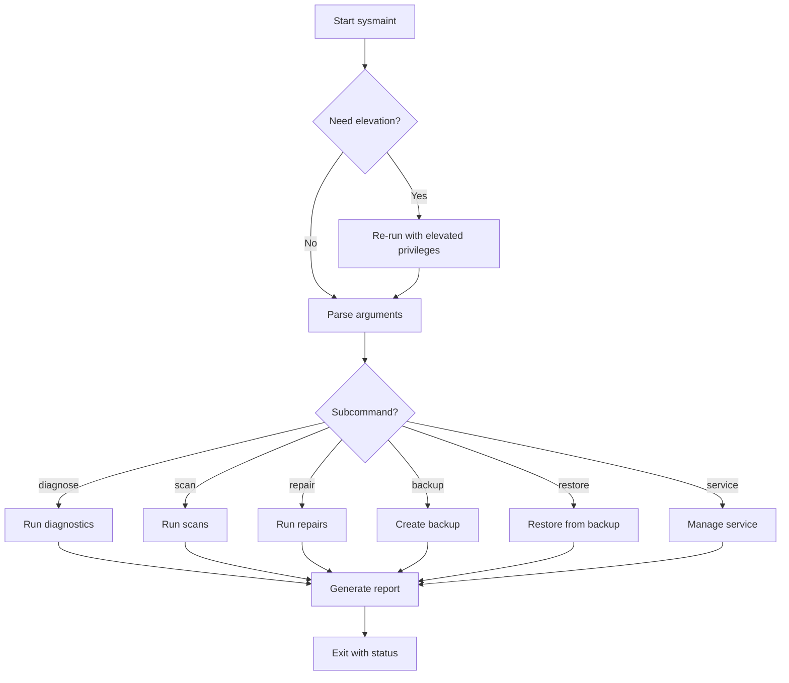

# SysMaint

**Cross-Platform System Maintenance Toolkit**

SysMaint is a Python-based, modular CLI toolkit that helps you diagnose, scan, repair, back up, and restore both Windows and Linux systems. It wraps common system tools like `chkdsk`, `fsck`, `DISM`, `SFC`, `systemctl`, ClamAV, YARA, and more into one unified command-line interface.

The project is designed to be safe by default: diagnostics are mostly read-only, destructive actions require explicit confirmation, and all operations are logged with timestamps. You can run it manually or schedule it with cron or Task Scheduler.

---

## Badges


---

## Table of Contents

- [Workflow](#workflow)
- [Project Structure](#project-structure)
- [Use Cases](#use-cases)
- [Features](#features)
- [Installation](#installation)
- [Configuration](#configuration)
- [Usage](#usage)
- [Forking and Expanding](#forking-and-expanding)
- [Testing](#testing)
- [Contributing](#contributing)

---

## Workflow

The following Mermaid diagram shows the high‑level flow from CLI invocation to module execution.



---

## Project Structure

<details>
<summary>Click to expand the full project tree</summary>

```
sysmaint/
├── __init__.py
├── __main__.py
├── cli.py
├── config.py
├── logging_setup.py
├── requirements.txt
├── modules/
│   ├── __init__.py
│   ├── backup.py
│   ├── disk.py
│   ├── drivers.py
│   ├── integrity.py
│   ├── malware.py
│   ├── memory.py
│   ├── report.py
│   ├── restore.py
│   └── services.py
├── utils/
│   ├── __init__.py
│   ├── common.py
│   ├── escalate.py
│   ├── linux.py
│   ├── parsers.py
│   └── windows.py
└── tests/
    ├── __init__.py
    └── test_disk.py
```
</details>

---

## Use Cases

- **Routine Maintenance**  
  Run weekly checks to scan disks, services, memory, and drivers. Detect and fix common issues before they become serious.

- **Incident Recovery**  
  After a crash or suspected malware infection, run a full scan, quarantine threats, and restore system health.

- **Deployment / Inventory**  
  Collect system health information across multiple Windows and Linux hosts for reporting or compliance.

- **Automation / Remote Admin**  
  Integrate SysMaint into cron jobs or Task Scheduler for unattended or semi‑interactive maintenance.

---

## Features

- Cross‑platform support (Windows 10/11 and popular Linux distributions)
- Modular architecture with separate Python files for each functional area
- Subcommands for `diagnose`, `scan`, `repair`, `backup`, `restore`, `service`, and `update-db`
- Privilege escalation via UAC on Windows and `sudo` on Linux, only when needed
- Safe defaults: mostly read‑only diagnostics with explicit commands for fixes
- Malware scanning using ClamAV, YARA rules, and optional VirusTotal API
- System integrity checks via `DISM`/`SFC` on Windows and `dpkg`/`rpm`/`journalctl` on Linux
- Backup and restore support (Windows restore points, Linux tar/snapshots)
- Structured JSON or human‑readable reporting
- Timestamped logging to console and file
- Configurable via YAML/JSON file or command‑line flags
- `--dry-run` and `--yes` flags for safe automation

---

## Installation

### Prerequisites

- Python 3.8 or higher
- Administrative/root privileges for full functionality
- Optional external tools:
  - ClamAV (`clamscan`, `freshclam`) for malware scanning
  - YARA (`yara-python`) for pattern‑based scans
  - `smartmontools` for disk health on Linux

### Install from source

```bash
git clone https://github.com/your-username/sysmaint.git
cd sysmaint
pip install -r requirements.txt
```

### Install as a package (optional)

```bash
pip install .
```

Then run with:

```bash
python -m sysmaint --help
```

---

## Configuration

SysMaint can be configured with a YAML or JSON file. Here is an example `sysmaint.yaml`:

```yaml
logging:
  level: INFO
  file: /var/log/sysmaint.log

diagnostics:
  disk: true
  memory: true
  services: true
  drivers: false

malware:
  use_clamav: true
  use_yara: true
  yara_rules_path: /etc/sysmaint/rules.yar
  use_virustotal: false
  vt_api_key: ""

repair:
  auto_create_restore_point: true
  backup_dir: /opt/sysmaint/backups
  lvm_vg: vg0

services:
  enable: true
  expected_services:
    - sshd
    - apache2

system:
  offline_mode: false
  auto_yes: false
```

Use it with:

```bash
sysmaint --config sysmaint.yaml diagnose --all
```

CLI flags override config file values. For example, `--offline` will force offline mode even if the config says otherwise.

---

## Usage

### Diagnose

```bash
# Run all diagnostics
python -m sysmaint diagnose --all

# Run only disk and memory checks
python -m sysmaint diagnose --disk --memory
```

### Scan

```bash
# Full local scan with ClamAV and YARA (offline)
python -m sysmaint scan --clamav --yara --offline

# Integrity check only
python -m sysmaint scan --integrity
```

### Repair

```bash
# Repair disk and system files, auto‑confirm
python -m sysmaint repair --disk --files --yes

# Dry run to see what would be done
python -m sysmaint repair --all --dry-run
```

### Backup and Restore

```bash
# Create a Windows restore point
python -m sysmaint backup --restore-point

# Restore from a snapshot (Linux example)
python -m sysmaint restore --snapshot root_snap
```

### Service Management

```bash
# Check status of a service
python -m sysmaint service status sshd

# Restart a service
python -m sysmaint service restart nginx
```

### Update Malware Database

```bash
python -m sysmaint update-db
```

---

## Forking and Expanding

SysMaint is built to be extended. Here is how you can fork it and add your own modules or modify existing ones.

1. **Fork the repository** on GitHub (or your preferred Git host).
2. **Clone your fork** locally:
   ```bash
   git clone https://github.com/your-username/sysmaint.git
   cd sysmaint
   ```
3. **Create a new branch** for your feature or fix:
   ```bash
   git checkout -b feature/my-new-module
   ```
4. **Add a new module** inside `sysmaint/modules/`. Each module should expose a function that returns a dictionary. For example:
   ```python
   # sysmaint/modules/custom.py
   def run_custom_check(config):
       return {"status": "ok", "details": "Custom check passed"}
   ```
5. **Register the new command** in `cli.py`. Add a subparser and a handler function.
6. **Test your changes** locally with:
   ```bash
   python -m sysmaint custom-command --help
   ```
7. **Push your branch** and open a pull request.

### Guidelines

- Always include type hints and docstrings.
- Keep functions small and focused.
- Log important actions and results.
- Respect the existing configuration system.
- Write unit tests for any new functionality.

---

## Testing

Run the test suite with pytest:

```bash
pytest
```

The tests use `unittest.mock` to avoid running real system commands. They are designed to run on any platform.

For integration tests, use a virtual machine or container with the appropriate operating system.

---

## Contributing

Contributions are welcome. Please read the [CONTRIBUTING.md](CONTRIBUTING.md) file for details on how to submit issues and pull requests.

---

## Acknowledgements

SysMaint relies on the following open‑source tools and libraries:

- [psutil](https://github.com/giampaolo/psutil) – cross‑platform system monitoring
- [PyYAML](https://pyyaml.org/) – YAML parsing
- [yara-python](https://github.com/VirusTotal/yara-python) – YARA pattern matching
- [requests](https://docs.python-requests.org/) – HTTP client for VirusTotal API
- ClamAV, SFC, DISM, fsck, systemd – the underlying system tools that make this possible

---

**Note:** Always run SysMaint with appropriate privileges and be aware of the potential impact of repair actions. Use `--dry-run` and `--yes` carefully.