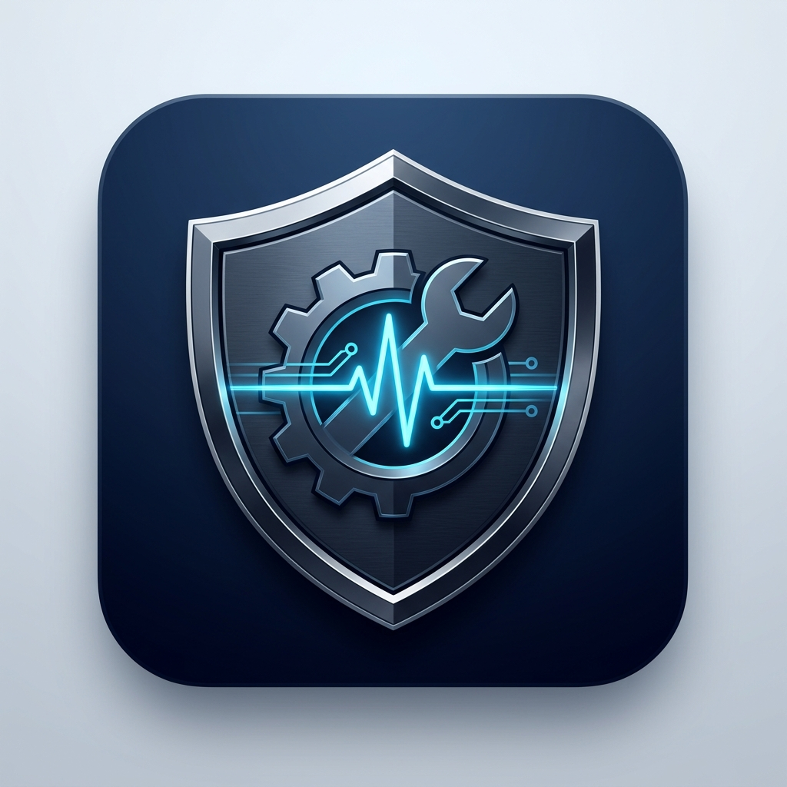
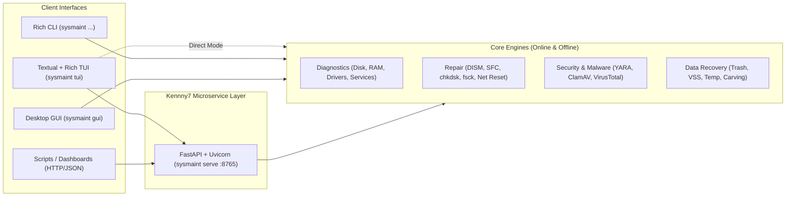
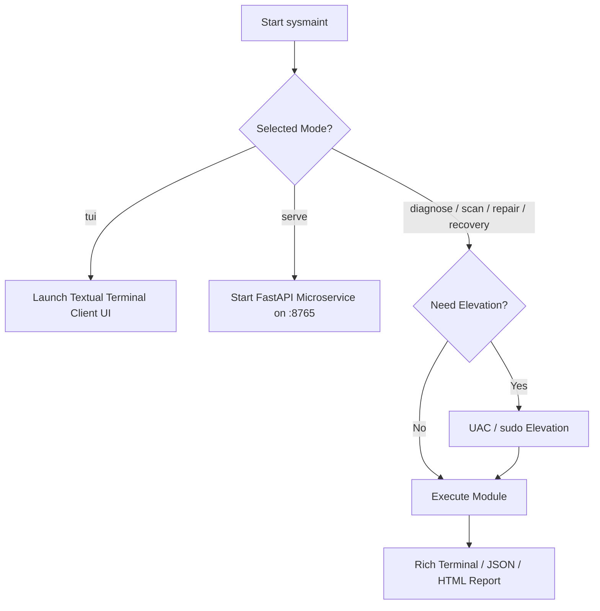

<div align="center">



# SysMaint

**Cross-Platform System Maintenance, Security & Data Recovery Microservice**

*Version 3.0.0 — Sentinel Microservice | Built by Kennny7 Microservices*

<br />

<a href="USER_GUIDE.md"></a>
<a href="CHANGELOG.md"></a>

<br /><br />


</div>

---

> [!NOTE]
> **New to command-line tools?** Open the step-by-step **[User Guide](USER_GUIDE.md)** for plain-English instructions, microservice health checks, and ready-to-paste examples.

---

## Architecture Overview

SysMaint v3.0.0 (`Sentinel Microservice`) evolves the original maintenance toolkit into a modular **microservice + terminal client UI** architecture that works both **offline** and **online**.



### Execution Workflow



---

## Key Capabilities

| Domain | Windows Tools & Features | Linux Tools & Features | Offline Capable |
| :--- | :--- | :--- | :--- |
| **Microservice** | FastAPI REST API + OpenAPI (`/docs`) | FastAPI REST API + OpenAPI (`/docs`) | Yes |
| **Terminal Client UI** | Textual + Rich 5-tab dashboard | Textual + Rich 5-tab dashboard | Yes |
| **System Repair** | `DISM /RestoreHealth` (online/WIM), `sfc /scannow`, `chkdsk` | `dpkg --verify`, `rpm -Va`, `pacman -Qk`, `fsck`, `journalctl` | Yes |
| **Network Repair** | `netsh winsock reset`, `netsh int ip reset`, DNS flush | `NetworkManager` restart, `resolvectl` DNS flush | Yes |
| **Malware & Security** | Built-in YARA heuristics, ClamAV, VirusTotal, Defender audit | Built-in YARA heuristics, ClamAV, VirusTotal, firewall audit | Yes (YARA/ClamAV) |
| **Data Recovery** | Recycle Bin restore, `vssadmin` VSS shadows, Office temp drafts, file carving | FreeDesktop Trash restore, Btrfs/Timeshift, temp drafts, file carving | Yes |

---

## Quick Start (with `uv`)

```bash
git clone https://github.com/Kennny7/sysmaint.git
cd sysmaint
uv sync
```

Launch the interactive **Terminal Client UI**:
```bash
uv run sysmaint tui
```

Start the **Microservice**:
```bash
uv run sysmaint serve --host 127.0.0.1 --port 8765
```

> [!TIP]
> You can connect the Terminal Client UI directly to a running microservice instance:
> `uv run sysmaint tui --server http://127.0.0.1:8765`

---

## Command Reference & Expandable Guides

<details>
<summary><strong>1. Diagnostics, Integrity & System Repair</strong></summary>

```bash
# 1-Click read-only health overview
sysmaint smart-scan

# Run specific diagnostics
sysmaint diagnose --disk --memory --drivers

# Check Windows DISM/SFC or Linux package integrity (read-only)
sysmaint scan --integrity

# Repair system files (preview first with --dry-run)
sysmaint repair --files --dry-run
sysmaint repair --files

# Offline DISM repair using a local WIM/ESD image
sysmaint repair --files --offline-source D:\sources\install.wim

# Reset corrupted network stack (Winsock/TCP-IP or NetworkManager)
sysmaint network reset --dry-run
sysmaint network reset
```

</details>

<details>
<summary><strong>2. Malware Scanning & Security Audit</strong></summary>

```bash
# Audit firewall, antivirus, and privilege posture
sysmaint security

# Offline malware scan using built-in YARA rules and ClamAV
sysmaint scan --yara --clamav --offline

# Scan a specific folder
sysmaint scan --yara --target "C:\Users\Admin\Downloads"

# Update ClamAV signatures (online)
sysmaint update-db
```

</details>

<details>
<summary><strong>3. Data Recovery (Trash, Shadow Copies, Temp Drafts, File Carving)</strong></summary>

```bash
# List deleted items in Recycle Bin (Windows) or Trash (Linux)
sysmaint recovery trash

# Restore a deleted item to a safe destination
sysmaint recovery restore --name "invoice.pdf" --dest "./recovered"

# List Volume Shadow Copies (Windows) or Btrfs/Timeshift snapshots (Linux)
sysmaint recovery shadows

# Scan for unsaved Office / LibreOffice / temp drafts
sysmaint recovery temp

# Carve lost files (pdf, png, jpg, zip, sqlite) from a raw disk image
sysmaint recovery carve --source "./disk.img" --dest "./carved_out" --types pdf png jpg
```

</details>

<details>
<summary><strong>4. Project Structure</strong></summary>

```text
sysmaint/
├── assets/
│   └── sysmaint-icon.jpg
├── src/sysmaint/
│   ├── __init__.py            # Version (3.0.0), Codename, Kennny7 Microservices brand
│   ├── __main__.py
│   ├── cli.py                 # Unified CLI entrypoint
│   ├── config.py              # YAML/JSON configuration dataclasses
│   ├── logging_setup.py
│   ├── modules/
│   │   ├── backup.py          # Restore points & snapshots
│   │   ├── cleaner.py         # Temp, browser, package & log cleanup
│   │   ├── disk.py            # Partition usage, SMART, chkdsk/fsck
│   │   ├── drivers.py
│   │   ├── integrity.py       # DISM/SFC (online & offline WIM) & Linux pkg verify
│   │   ├── malware.py         # YARA, ClamAV, VirusTotal
│   │   ├── memory.py
│   │   ├── network.py         # Ping, DNS flush, ports, network stack reset
│   │   ├── optimizer.py       # 1-Click smart scan & auto-fix
│   │   ├── recovery.py        # Trash/Recycle Bin, VSS, temp drafts, file carving
│   │   ├── report.py          # JSON, Rich & HTML reporting
│   │   ├── restore.py
│   │   ├── scheduler.py
│   │   ├── security.py
│   │   ├── services.py
│   │   ├── startup.py
│   │   └── sysinfo.py
│   ├── service/
│   │   └── server.py          # FastAPI + Uvicorn microservice
│   ├── tui/
│   │   └── app.py             # Textual + Rich Terminal Client UI
│   ├── gui/                   # Optional CustomTkinter Desktop GUI
│   └── utils/
├── tests/
├── pyproject.toml             # uv & hatchling configuration
├── USER_GUIDE.md              # Non-technical & CLI user guide
└── CHANGELOG.md
```

</details>

---

## Testing & Quality Checks

```bash
uv run pytest -v
uv run ruff check src tests
```

---

<div align="center">

**SysMaint v3.0.0 (Sentinel Microservice)** — **Kennny7 Microservices**

[User Guide](USER_GUIDE.md) | [Changelog](CHANGELOG.md) | [Issues](https://github.com/Kennny7/sysmaint/issues)

</div>
